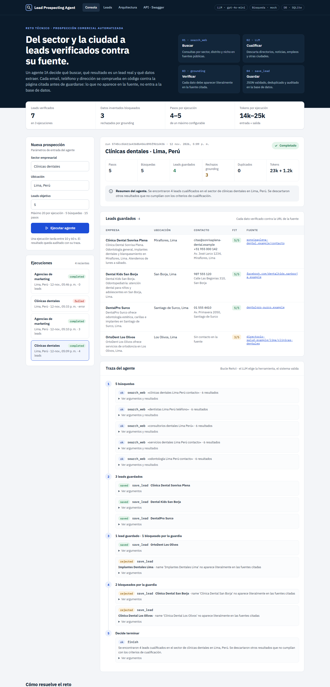
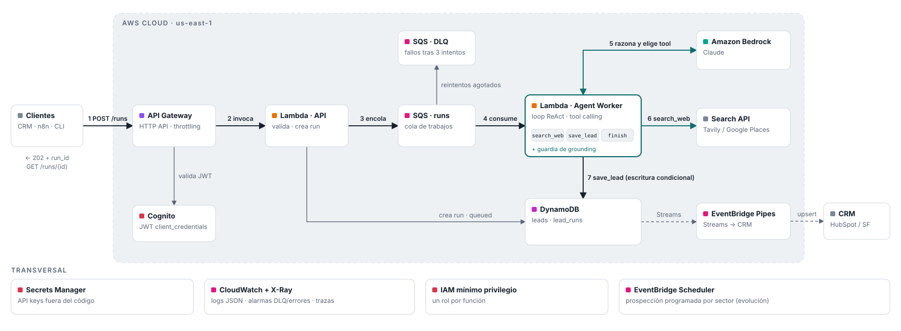

# Lead Prospecting Agent

Prueba de concepto de un **agente IA que busca, extrae, cualifica y almacena leads** desde fuentes públicas, a partir de un **sector** y una **ubicación** configurables.

El LLM decide en cada paso qué hacer mediante **tool calling (bucle ReAct)**: buscar (`search_web`), guardar un lead estructurado (`save_lead`) o terminar (`finish`). Cada lead que intenta guardar pasa por una **guardia de grounding** en código que verifica que cada dato (nombre, emails, teléfonos, web, dirección, redes) aparezca literalmente en las fuentes citadas. Si algo no aparece, el guardado se rechaza y el agente recibe el detalle exacto para corregirlo.

```
CLI / API ──► ProspectingService ──► LeadAgent (loop ReAct)
                                        │  ├─ search_web ──► Tavily | Mock
                                        │  ├─ save_lead  ──► validación Pydantic ► grounding ► dedup ► DB
                                        │  └─ finish
                                        └─ LLMClient ──► Anthropic | Bedrock | OpenAI-compatible
```

## Índice

1. [Inicio rápido (sin claves)](#1-inicio-rápido-sin-claves)
2. [Instalación y ejecución](#2-instalación-y-ejecución)
   - [Interfaz web](#25-interfaz-web)
   - [Evidencia de ejecución real](#26-evidencia-de-ejecución-real)
3. [Estructura del proyecto](#3-estructura-del-proyecto)
4. [Diseño agéntico](#4-diseño-agéntico)
5. [Prompt engineering y control de alucinaciones](#5-prompt-engineering-y-control-de-alucinaciones)
6. [Arquitectura en AWS](#6-arquitectura-en-aws)
7. [Decisiones técnicas](#7-decisiones-técnicas)
8. [Limitaciones y mejoras futuras](#8-limitaciones-y-mejoras-futuras)

---

## 1. Inicio rápido (sin claves)

```bash
git clone https://github.com/burne-di/lead-prospecting-agent.git && cd lead-prospecting-agent
python -m venv .venv && source .venv/bin/activate      # Windows: .venv\Scripts\activate
pip install -e ".[dev]"

pytest -q                         # 57 tests: loop del agente, grounding, SQLite, DynamoDB (moto), API, Lambda, CLI
python scripts/demo_offline.py    # recorre el pipeline completo con un LLM simulado
```

La demo offline usa el **mock tool de búsqueda real** y un LLM con decisiones guionizadas. Sirve para ver el loop, un rechazo por grounding y la autocorrección sin gastar tokens:

```
🧠 Busco clínicas dentales en distritos de Lima con datos de contacto.
   → search_web('clínica dental Lima contacto Miraflores Olivos')
   ← ok        6

🧠 Descarto el directorio, el aviso de empleo y el laboratorio proveedor. Guardo Sonrisa Plena, OrtoDent y DentalPro.
   → save_lead('Clínica Dental Sonrisa Plena')
   → save_lead('OrtoDent Los Olivos')
   → save_lead('DentalPro Surco')
   ← rejected  ["email 'info@sonrisaplena-dental.example' no aparece en las fuentes citadas: elimínalo"]
   ← saved     b37b1e9675c7ebc2
   ← saved     27c4b24b5bde88ad

🧠 El email info@ no estaba en la fuente: lo elimino y reintento. Busco odontopediatría.
   → save_lead('Clínica Dental Sonrisa Plena')
   → search_web('odontopediatría San Borja Lima')
   ← saved     dfbeaf46a6447232
   ← ok        6
   ...
✔ run completed: 4 guardados, 1 rechazo(s) por grounding, 2 búsquedas, 5 pasos
```

Lead tal como queda en la base de datos:

```json
{
  "name": "OrtoDent Los Olivos",
  "sector": "Ortodoncia",
  "summary": "Consultorio especializado en ortodoncia con brackets metálicos, estéticos y alineadores en Los Olivos.",
  "website": "https://ortodent-losolivos.example",
  "location": "Los Olivos, Lima",
  "contact": {
    "emails": ["contacto@ortodent-losolivos.example"],
    "phones": ["(01) 555-0381"],
    "address": "Av. Carlos Izaguirre 845, Los Olivos, Lima",
    "social_profiles": []
  },
  "source_urls": ["https://ortodent-losolivos.example/nosotros"],
  "fit_score": 5,
  "fit_reason": "Consultorio de ortodoncia en Lima Norte con contacto completo.",
  "lead_id": "b37b1e9675c7ebc2",
  "run_id": "684d361d378b4c978c97eadc1337b0fc",
  "query_sector": "Clínicas dentales",
  "query_location": "Lima, Perú",
  "created_at": "2026-11-12T21:44:53.602592Z"
}
```

## 2. Instalación y ejecución

Requisitos: **Python 3.11+**. Docker solo si quieres probar DynamoDB Local.

### 2.1 Configuración

```bash
cp .env.example .env
```

Variables mínimas según lo que quieras usar (el resto tiene valores por defecto):

| Escenario | Variables |
|---|---|
| Claude vía API de Anthropic | `LLM_PROVIDER=anthropic`, `ANTHROPIC_API_KEY`, `LLM_MODEL` (p. ej. `claude-haiku-4-5`) |
| Claude vía Amazon Bedrock | `LLM_PROVIDER=bedrock`, `AWS_REGION`, `LLM_MODEL` (ID o inference profile) + credenciales AWS estándar |
| GPT-4o-mini / Groq / Ollama | `LLM_PROVIDER=openai`, `OPENAI_API_KEY`, `OPENAI_BASE_URL`, `LLM_MODEL` |
| Búsqueda real | `SEARCH_PROVIDER=tavily`, `TAVILY_API_KEY` |
| Búsqueda simulada | `SEARCH_PROVIDER=mock` (por defecto; cubre clínicas dentales y agencias de marketing en Lima) |

`.env` está en `.gitignore`; ninguna clave se sube al repositorio. Si falta una clave, el run queda en `failed` con el motivo (`ANTHROPIC_API_KEY no configurada`) en lugar de romper la API.

### 2.2 CLI

```bash
lead-agent run --sector "Clínicas dentales" --location "Lima, Perú" --max-leads 5
lead-agent run --sector "Agencias de marketing" --location "Lima, Perú" --json
lead-agent list --sector "Clínicas dentales"
```

### 2.3 API (FastAPI)

```bash
uvicorn lead_agent.api.app:app --reload --port 8080      # docs interactivas: http://localhost:8080/docs
```

```bash
curl -X POST localhost:8080/runs -H "Content-Type: application/json" \
     -d '{"sector": "Clínicas dentales", "location": "Lima, Perú", "max_leads": 5}'

curl localhost:8080/runs/<run_id>                  # auditoría: estado, pasos, búsquedas, rechazos, tokens
curl "localhost:8080/leads?sector=Clínicas%20dentales"
```

| Método | Ruta | Descripción |
|---|---|---|
| `POST` | `/runs` | Lanza el agente. `200` con los leads en modo `sync`; `202` + `run_id` en modo `async` (SQS) |
| `GET` | `/runs` | Historial de ejecuciones (más recientes primero) |
| `GET` | `/runs/{run_id}` | Estado, métricas y traza de la ejecución, con sus leads |
| `GET` | `/leads?sector=&limit=` | Leads guardados |
| `GET` | `/health` | Healthcheck |
| `GET` | `/` | Interfaz web |

### 2.4 Base de datos

Por defecto usa **SQLite** (`data/leads.db`) sin configurar nada. Para usar **DynamoDB Local**:

```bash
docker compose up -d dynamodb
# en .env: STORAGE_BACKEND=dynamodb  y  DYNAMODB_ENDPOINT_URL=http://localhost:8000
#          AWS_ACCESS_KEY_ID=local   y  AWS_SECRET_ACCESS_KEY=local
python scripts/create_dynamodb_tables.py
lead-agent run --sector "Clínicas dentales" --location "Lima, Perú"
```

### 2.5 Interfaz web

Con la API levantada, abre **http://localhost:8080**. Desde ahí lanzas una prospección (sector, ubicación, leads objetivo) y ves:

- los **leads** guardados con su `fit_score`, contacto y URL de la fuente;
- la **traza del agente**: cada paso del bucle ReAct, cada tool que el LLM decidió llamar, sus argumentos y lo que respondió el sistema (`ok`, `saved`, `rejected` con el motivo, `duplicate`);
- el **historial** de ejecuciones y la pestaña con todos los leads de la base de datos.

Enlace directo a una ejecución: `http://localhost:8080/?run=<run_id>`. La documentación interactiva de la API sigue en `/docs`.

### 2.6 Evidencia de ejecución real

[`docs/evidence/`](docs/evidence) contiene dos corridas reales con **OpenAI gpt-4o-mini** + búsqueda mock, sobre una base limpia:

| Corrida | Resultado | Archivos |
|---|---|---|
| Clínicas dentales · Lima | `completed` · 5 pasos · 5 búsquedas · **4 leads** · 3 rechazos por grounding (nombres inventados por el modelo, corregidos en el paso siguiente) · 24.5k tokens | [JSON](docs/evidence/run_clinicas_dentales.json) · [logs](docs/evidence/run_clinicas_dentales.log.jsonl) · [captura](docs/evidence/ui_run_clinicas_dentales.png) |
| Agencias de marketing · Lima | `completed` · 4 pasos · 5 búsquedas · **3 leads** · directorio, empleo, agencia de Trujillo y SaaS descartados · 13.8k tokens | [JSON](docs/evidence/run_agencias_marketing.json) · [logs](docs/evidence/run_agencias_marketing.log.jsonl) |

- `run_*.json`: salida de `lead-agent run --json`: el run completo (estado, métricas, rechazos, **traza paso a paso**) y los leads guardados.
- `run_*.log.jsonl`: logs estructurados (`LOG_FORMAT=json`), uno por línea, el mismo formato que irá a CloudWatch Logs Insights.



Para reproducirlas:

```bash
# PowerShell: $env:LOG_FORMAT="json"
LOG_FORMAT=json lead-agent run --sector "Clínicas dentales" --location "Lima, Perú" --json > run.json 2> run.log.jsonl
```

## 3. Estructura del proyecto

```
src/lead_agent/
├── api/app.py              Controlador HTTP (FastAPI): valida entrada y mapea errores
├── cli.py                  Controlador CLI
├── handlers/aws_lambda.py  Controladores Lambda: API (Mangum) y worker SQS
├── services/               Casos de uso: crear/ejecutar run, despacho inline o SQS
├── agent/
│   ├── runner.py           Bucle ReAct con límites de pasos
│   ├── tools.py            Contrato (JSON Schema) + handler de cada tool
│   ├── grounding.py        Verificación determinista de datos contra la evidencia
│   └── prompts.py          System prompt y prompt de tarea
├── llm/                    Puerto LLMClient + adaptadores Claude (Anthropic/Bedrock), OpenAI-compatible y guionizado
├── search/                 Puerto SearchProvider + Tavily + mock (fixtures/*.json)
├── storage/                Puerto LeadRepository + SQLite + DynamoDB
├── domain/models.py        Entidades Pydantic (Lead, Run, RunRequest...) sin dependencias de infraestructura
├── container.py            Composition root: único lugar que conecta implementaciones concretas
├── config.py               Settings tipadas desde .env
└── logging_setup.py        Logs JSON estructurados
infra/template.yaml         AWS SAM: la arquitectura del diagrama como IaC (validada con cfn-lint)
docs/architecture.*         Diagrama AWS: SVG (también en la UI), PNG 2x y .drawio editable
scripts/                    Demo offline y creación de tablas DynamoDB
docs/evidence/               Corridas reales con gpt-4o-mini: JSON, logs y capturas de la UI
tests/                      57 tests, sin red ni claves
```

Las dependencias apuntan hacia adentro: **controladores → servicio → agente → puertos** (`LLMClient`, `SearchProvider`, `LeadRepository`). Cambiar SQLite por DynamoDB, Tavily por Google Places o Claude por GPT es una variable de entorno; el agente no cambia. El mismo `ProspectingService` lo usan la CLI, la API local y las dos Lambdas.

## 4. Diseño agéntico

**Tools expuestas al LLM**

| Tool | Qué decide el LLM | Qué garantiza el código |
|---|---|---|
| `search_web(query)` | Qué buscar y cuándo, reformulando por distrito o nicho | Presupuesto de búsquedas (`AGENT_MAX_SEARCHES`), guarda la evidencia vista |
| `save_lead(...)` | Qué resultado es un lead y qué datos extraer | JSON Schema estricto (Pydantic, `extra=forbid`), grounding, dedup atómico, objetivo de leads |
| `finish(summary)` | Cuándo terminar | Cierra el run y guarda el resumen |

**Bucle** (`agent/runner.py`): el modelo recibe el historial y las tools; si pide herramientas se ejecutan todas las del turno y sus resultados vuelven como `tool_result`; se repite hasta `finish` o hasta `AGENT_MAX_STEPS`. Errores de validación o de grounding se devuelven como `tool_result` con `is_error`, de modo que el modelo **se autocorrige** en el siguiente paso en lugar de romper la ejecución. Una tool desconocida o un fallo interno tampoco tumban el run. Si el modelo responde con texto libre, recibe un único recordatorio de que solo cuentan las acciones con herramientas.

**Salvaguardas observadas en corridas reales** (cada una salió de un fallo concreto de gpt-4o-mini):

- *`finish` prematuro*: el modelo llamaba a `save_lead` y `finish` en el mismo turno y no llegaba a ver los rechazos. Ahora `finish` se ejecuta al final del turno y, si hubo un guardado rechazado, se ignora una vez para que pueda corregir.
- *Bucle de duplicados*: el modelo repetía los mismos `save_lead` hasta agotar los pasos. Ahora `duplicate` le dice explícitamente que no lo repita, y una **guardia de progreso** avisa tras 2 pasos sin avance (sin lead nuevo ni búsqueda útil) y detiene el run tras 4.

**Garantías de la ejecución**

- **Idempotencia**: `lead_id` = hash del dominio web (o nombre + ubicación si solo hay redes sociales). Inserción condicional (`attribute_not_exists` en DynamoDB, `PRIMARY KEY` en SQLite): el mismo lead no se guarda dos veces ni en paralelo.
- **Reentregas de SQS**: un run que ya no está en `queued` no se vuelve a ejecutar.
- **Auditoría**: cada run guarda estado, pasos, búsquedas, rechazos, duplicados, tokens y el resumen del agente.

## 5. Prompt engineering y control de alucinaciones

Defensa en dos capas: **el prompt reduce las alucinaciones y el código bloquea las que pasen.**

**En el prompt** (`agent/prompts.py`)
- *Closed world*: "si un dato no aparece en un resultado de búsqueda, para ti no existe".
- Criterios de cualificación con **contraejemplos** explícitos: directorios, rankings, noticias, avisos de empleo, otra ciudad, proveedores del sector.
- Reglas campo a campo: nombre literal, resumen solo con lo que dice la fuente, nunca construir `info@dominio`, nunca completar dígitos, no usar contactos de terceros (el correo comercial del directorio, el de RR. HH. del portal de empleo).
- Rúbrica de `fit_score` de 1 a 5 para que la puntuación sea consistente entre ejecuciones.
- Defensa ante *prompt injection*: el contenido web es dato, nunca instrucción.
- `temperature=0`.

**En el código**
- La salida estructurada no se parsea de texto libre: el **JSON Schema de `save_lead` se genera del modelo Pydantic `LeadDraft`**, así que el contrato y la validación son la misma fuente de verdad.
- `grounding.py` verifica cada valor contra el texto de **las URLs citadas** (no de cualquier resultado): emails literales, teléfonos normalizados por dígitos (`+51 955 000 142` = `955000142`), dominio web, perfiles sociales, dirección por cobertura de tokens y números exactos. Las `source_urls` deben haber sido devueltas por `search_web`.

## 6. Arquitectura en AWS



Versiones: [SVG](docs/architecture.svg) · [PNG alta resolución](docs/architecture.png) (para presentaciones) · [draw.io editable](docs/architecture.drawio) con las formas oficiales de AWS (`mxgraph.aws4`) y el mismo layout. El diagrama también se ve en la interfaz web (sección **Arquitectura**, o directo en `/architecture.svg`). Definición desplegable con AWS SAM: [`infra/template.yaml`](infra/template.yaml).

1. El cliente (CRM, n8n, un front) llama a **API Gateway (HTTP API)** con un JWT de **Cognito** (`client_credentials`, máquina a máquina). Hay throttling por ruta.
2. La **Lambda API** valida, crea el run en DynamoDB (`queued`) y lo encola en **SQS**. Responde `202` en milisegundos; el cliente consulta `GET /runs/{id}`.
3. La **Lambda Agent Worker** consume la cola (1 mensaje = 1 run) y ejecuta el bucle ReAct contra **Bedrock (Claude)** y la API de búsqueda.
4. Los leads se escriben en **DynamoDB** con escritura condicional. **DynamoDB Streams + EventBridge Pipes** pueden sincronizarlos con el CRM sin acoplarlo al agente.

**Por qué asíncrono**: un run del agente tarda decenas de segundos, por encima de lo razonable para una petición HTTP. La cola desacopla la API del agente, absorbe picos y permite reintentos. `MaximumConcurrency` en el event source limita cuántos agentes corren a la vez y protege las cuotas de Bedrock y el rate limit del buscador. Tras 3 fallos el mensaje pasa a la **DLQ**, con una alarma de CloudWatch.

**Escalabilidad y operación**: todo es serverless y pago por uso (Lambda en arm64, DynamoDB on-demand, SQS). Logs JSON estructurados para CloudWatch Logs Insights, trazas con X-Ray, PITR y cifrado en DynamoDB, TTL de 90 días en la tabla de runs, un rol IAM por función con permisos mínimos y claves en Secrets Manager.

## 7. Decisiones técnicas

**Framework de IA: SDK oficial sin framework.** El bucle ReAct cabe en menos de 100 líneas legibles (`runner.py`). Con LangChain o LlamaIndex habría añadido una dependencia pesada y capas de abstracción para algo que el tool calling nativo ya resuelve, y habría ocultado justo lo que este reto evalúa: cómo se decide, valida y corrige cada paso. Un puerto propio `LLMClient` mantiene la portabilidad: el mismo adaptador sirve para la API de Anthropic y para Bedrock (misma Messages API) y hay otro para endpoints compatibles con OpenAI (GPT-4o-mini, Groq, Ollama). Si el flujo creciera a varios agentes o pasos con estado persistente, evaluaría Bedrock Agents o Step Functions antes que un framework genérico.

**Modelo: Claude Haiku (vía Bedrock en producción).** Es una tarea de extracción con herramientas, no de razonamiento profundo; Haiku tiene buen tool calling, baja latencia y bajo costo por lead, que es lo que importa al prospectar en volumen. Bedrock mantiene los datos dentro de la cuenta AWS, usa IAM en lugar de API keys y factura en la misma cuenta. Si la calidad de cualificación lo exige, subir a Sonnet es cambiar `LLM_MODEL`.

**Base de datos: SQLite en local, DynamoDB en producción.** SQLite permite clonar y ejecutar sin infraestructura. DynamoDB encaja con Lambda (sin pool de conexiones, escala a demanda), su escritura condicional da deduplicación atómica, el GSI por sector cubre la consulta principal y Streams habilita la integración con el CRM. Ambas implementan el mismo contrato y los tests corren contra las dos (DynamoDB con `moto`).

**Búsqueda: Tavily + mock.** Tavily devuelve el contenido relevante de cada página, no solo el snippet, y eso es lo que el LLM necesita para extraer contactos. El mock tool devuelve resultados crudos realistas que mezclan negocios válidos con ruido (directorios, noticias, empleos, otras ciudades, proveedores) para que el agente tenga que cualificar y no solo copiar. **Todas las empresas y datos de los fixtures son ficticios.**

## 8. Limitaciones y mejoras futuras

**Para producción**
- **Rate limits y costos**: cuotas de Bedrock por cuenta y región; los reintentos con backoff exponencial ya existen en los clientes, pero falta un presupuesto de tokens y de costo por run y por cliente (circuit breaker).
- **Cobertura de búsqueda**: una sola fuente. Sumar Google Places API (teléfono y dirección estructurados), páginas de contacto (`/contacto`) y RUC/SUNAT para validar razón social.
- **Scraping propio**: si se navegan sitios directamente, se necesitan proxies rotativos, respeto de `robots.txt` y términos de uso, y un navegador sin interfaz (Playwright) para sitios con JavaScript.
- **Enriquecimiento y deduplicación**: dedup difusa (nombres parecidos, mismo teléfono con distinto dominio) y fusión de datos de varios runs sobre el mismo lead.
- **Cumplimiento**: Ley N.º 29733 de Protección de Datos Personales (Perú) y GDPR si aplica: base legal para contactar, especialmente con personas naturales; retención y derecho de supresión.
- **Evaluación continua**: un *golden set* etiquetado para medir precisión y recall de cualificación y tasa de alucinación por versión de prompt y modelo; trazas de LLM (Langfuse o CloudWatch GenAI Observability).
- **Resiliencia del worker**: si una Lambda muere a mitad de run, este queda en `running`; falta un heartbeat con reintento de runs viejos (o migrar el bucle a Step Functions).
- **Secretos**: la plantilla resuelve el secreto de Tavily al desplegar; en producción conviene leerlo en tiempo de ejecución con la extensión Parameters and Secrets de Lambda.
- **Seguridad del LLM**: Bedrock Guardrails como capa adicional frente a prompt injection en contenido web.
- **Cualificación de la fuente**: el grounding verifica que cada dato esté en la fuente citada, pero no que la fuente sea el sitio del propio negocio. En la evidencia, el modelo guardó OrtoDent citando el directorio (con `fit_score` 3 y sin contacto). Siguiente paso: marcar dominios de directorios/agregadores y exigir al menos una fuente propia para `fit_score` ≥ 4.
- **Calidad del resumen del agente**: el `summary` de `finish` lo escribe el modelo y a veces cuenta mal; las métricas fiables son las del run (`lead_ids`, `rejected_saves`, `duplicates`).
- **Historial del agente**: el contexto crece con cada búsqueda; para runs largos conviene resumir o recortar resultados antiguos.

**Funcionales**
- Programación por sector (EventBridge Scheduler), webhooks al terminar un run y sincronización con HubSpot.
- Cualificación configurable por cliente (ICP: tamaño, servicios, señales de compra) en lugar de la rúbrica fija.
- `max_leads` hasta 20 por run; para volumen, dividir por distrito y paralelizar runs.

---

Autor: Ruben Dario Quispe Vilca
